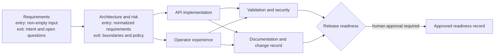

# Architecture and Orchestration

## Components

| Component | Responsibility |
| --- | --- |
| ASP.NET Core API | Link creation, metadata, redirect, analytics, orchestration commands, health, and static workbench. |
| `ShortLinkService` | HTTP(S) target validation, alias generation, expiry handling, click recording, and analytics queries. |
| SQLite / EF Core | Durable links and click events. Unique index on code; indexed click lookup by code and time. |
| `OrchestrationService` | Run state, dependency scheduling, stage gates, retries, fallback, decisions, rollback/replan, safe stop, and metrics. |
| `IAgentProvider` | Narrow extension point for stage execution. The default `DeterministicAgentProvider` consumes versioned upstream context and produces local review outputs. |
| `AuditTrail` | Append-only JSONL events with global sequence, actor, run/plan/stage, previous hash, and SHA-256 chain hash. |
| Workbench | Same-origin UI for the shortener and the operator's scenario, approval, clarification, replan, safe-stop, and audit workflows. |

## Dependency Graph

The executor finds all pending nodes whose dependencies have succeeded and runs each ready wave concurrently. API and UI are independent after architecture. Validation and documentation synchronize both branches before release readiness. Every node declares dependencies, an entry gate, and an exit gate in `WorkflowStageDefinition`; the graph is returned with each run for inspection.

## Control Flow and Governance

1. Intake accepts only a known scenario, validates requirement length, and rejects likely credential assignments before writing them to the audit log.
2. The ambiguous scenario parks at the requirements gate. No architecture or implementation node runs until a human supplies measurable constraints.
3. A successful stage writes its result into versioned upstream context. Provider failures are retried at most three times; documentation can fall back to a deterministic template. Failure of validation blocks downstream stages.
4. Release readiness is high impact and cannot advance until a reviewer records an approval and rationale. Rejection closes the run. The prototype never deploys.
5. Replan increments the plan version, records the rationale and rollback, clears superseded outputs, and schedules the new DAG. Prior decisions and audit events remain available.
6. Safe stop cancels the provider token, marks unfinished work blocked, and waits for the current execution wave to drain.

Replan and approval decisions are serialized per run. Stage execution uses a separate wave lock so an active run can still be stopped. Provider implementations must honor cancellation tokens and must not bypass orchestration policy.

## Audit and Metrics

Each audit line contains a monotonically increasing sequence, UTC timestamp, run ID, plan version, actor, action, optional stage ID, detail, previous hash, and current hash. The hash covers the serialized event payload and previous hash; the UI/API recomputes the chain before reporting it as valid.

- Success rate is successful terminal runs divided by completed terminal runs.
- Retry frequency is the fraction of current in-memory runs with one or more retries; retry count is also exposed.
- Rollback frequency is the fraction of current in-memory runs with one or more replans; rollback count is also exposed.
- MTTR is measured from a failed or safe-stopped plan to successful completion of its replan.
- End-to-end latency is the duration of completed runs, including time at a human gate.

Runs and metrics are process-local; the audit log persists across restarts. A production service should recover workflow snapshots or store them transactionally alongside audit events.

## Key Decisions and Trade-offs

- SQLite makes the prototype reproducible with no external service. `EnsureCreated` avoids migration setup but is not a production schema-evolution strategy.
- Redirect destinations are parsed and scheme-limited; the service never fetches destinations, avoiding server-side request forgery in the redirect flow.
- Only referrer host is retained, not full referrer URL or client IP. Retention and consent policy are not implemented.
- Rate limits are per-process and keyed by the observed remote address. Reverse-proxy forwarding must be configured and trusted before deployment.
- No source-writing tool, shell agent, credential, or deployment credential is available to the built-in provider. This narrows autonomy and leaves final artifact application under human control.
- User-provided actor names are trace labels only, not authenticated identities. The approval endpoint requires authentication/authorization before any production use.